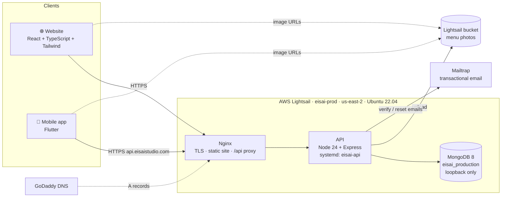
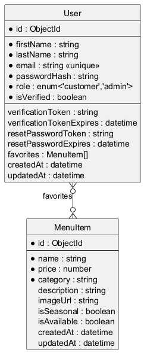
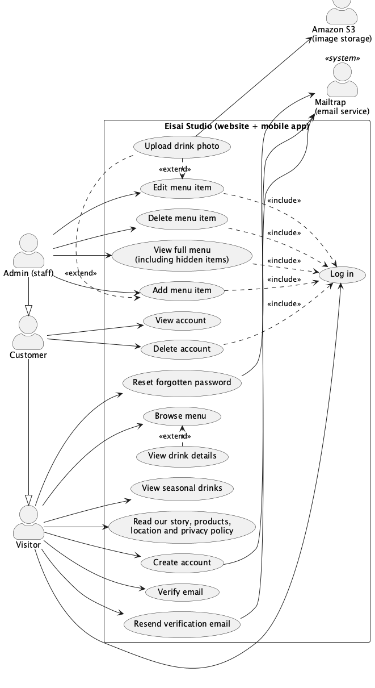
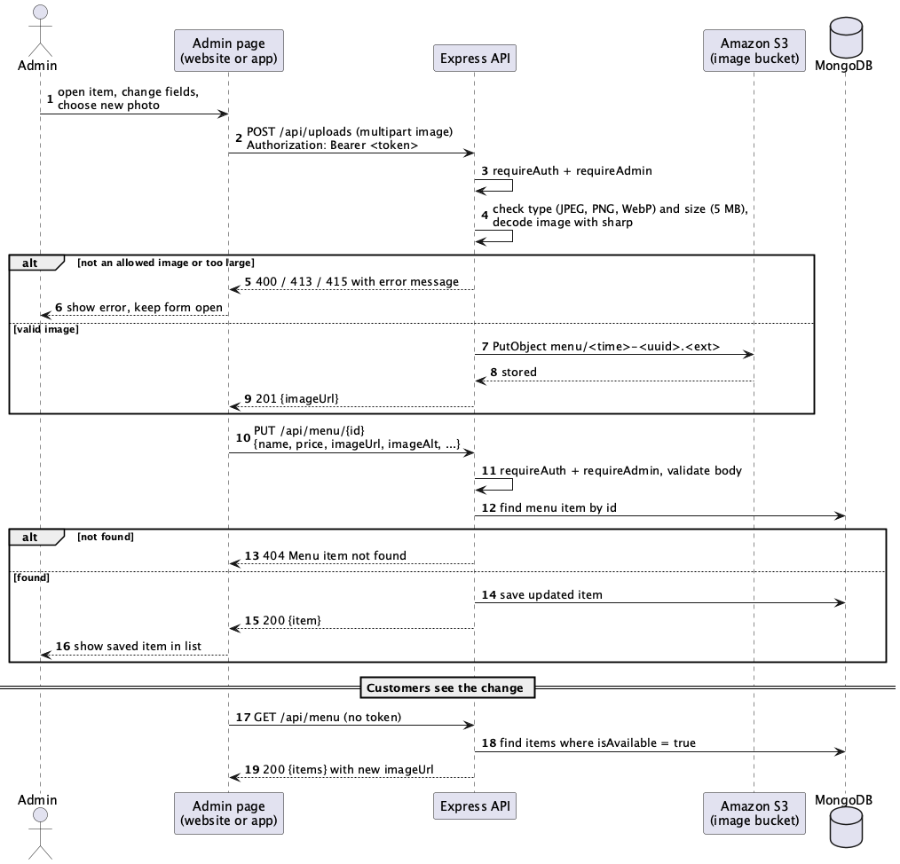

<p align="center">
  <a href="https://eisaistudio.com">
    
  </a>
</p>

<h3 align="center">Handoff guide</h3>

<p align="center">
  <em>everything Eisai Studio and the next developer need to keep the site whisking along</em> 🍵
</p>

<p align="center">
  <a href="https://eisaistudio.com"></a>
  <a href="https://api.eisaistudio.com/api/health"></a>
  
</p>

<p align="center">
  
  
  
</p>

---

> [!IMPORTANT]
> This repository is **public**. Never add passwords, API tokens, AWS account numbers or customer data to this file or any other file here. Secrets live only on the server, in `/etc/eisai/`.

**Two ways to read this guide:**

|                                                 | Start here                                                                                                                                                  |
| ----------------------------------------------- | ----------------------------------------------------------------------------------------------------------------------------------------------------------- |
| 🍵 **Eisai Studio** (owners, staff)             | [What you have](#-what-you-have) → [Your accounts](#-your-accounts) → [Editing the menu](#-editing-the-menu) → [Costs and key dates](#-costs-and-key-dates) |
| 🛠️ **Developers** (whoever maintains this next) | [Architecture](#%EF%B8%8F-architecture) → [Run it locally](#-run-it-locally) → [Deploying](#-deploying) → [Known gaps](#-known-gaps-and-next-steps)         |

<details>
<summary><b>Full table of contents</b></summary>

- **For Eisai Studio**
  - [What you have](#-what-you-have)
  - [Your accounts](#-your-accounts)
  - [Editing the menu](#-editing-the-menu)
  - [Giving someone staff access](#-giving-someone-staff-access)
  - [Costs and key dates](#-costs-and-key-dates)
  - [If something looks broken](#-if-something-looks-broken)
  - [Before adding new features](#%EF%B8%8F-before-adding-new-features)
- **For developers**
  - [Architecture](#%EF%B8%8F-architecture)
  - [Repository map](#%EF%B8%8F-repository-map)
  - [Run it locally](#-run-it-locally)
  - [Configuration](#%EF%B8%8F-configuration)
  - [Deploying](#-deploying)
  - [Running the server](#%EF%B8%8F-running-the-server)
  - [Mobile app](#-mobile-app)
  - [Known gaps and next steps](#-known-gaps-and-next-steps)
  - [Gotchas we learned the hard way](#-gotchas-we-learned-the-hard-way)
  - [All the other docs](#-all-the-other-docs)
- [Who built this](#-who-built-this)

</details>

---

# 🍵 For Eisai Studio

## 🎁 What you have

| What                 | Where                                                  | What it does                                                                                                                                                               |
| -------------------- | ------------------------------------------------------ | -------------------------------------------------------------------------------------------------------------------------------------------------------------------------- |
| **Website**          | [eisaistudio.com](https://eisaistudio.com)             | Home, menu with search, our story, products, location, privacy policy. Customers can create an account, verify their email, reset their password and delete their account. |
| **Menu editor**      | [eisaistudio.com/admin](https://eisaistudio.com/admin) | Staff add, edit, hide and delete drinks and upload drink photos. Only staff (admin) accounts can open it.                                                                  |
| **API** (the engine) | `api.eisaistudio.com`                                  | The website and app get the menu and handle sign-ins through it. You never need to visit it directly.                                                                      |
| **Mobile app**       | Android demo build ([details](docs/mobile-demo.md))    | Same menu and accounts as the website, plus a staff menu editor. **Not yet in the Google Play or Apple App Store.**                                                        |
| **Source code**      | This GitHub repository                                 | Everything needed to rebuild or change any of the above.                                                                                                                   |

Everything runs on **one small server in your AWS project** (Amazon Lightsail, Ohio region). The menu, customer accounts and photos all live there and in a storage bucket next to it. Nothing is stored on a student's laptop.

## 🔑 Your accounts

These are the services the site depends on. **Eisai Studio should own every one of them**, with logins kept in a password manager, so that nobody outside the business is ever required to keep the site running.

| Service                   | What it's for                                    | Login / where to manage                                                                                                                       | If you lose access                                                           |
| ------------------------- | ------------------------------------------------ | --------------------------------------------------------------------------------------------------------------------------------------------- | ---------------------------------------------------------------------------- |
| **AWS** (your "project")  | The server, database, photo storage, billing     | [AWS Settings](https://settings.aws.com/) for billing and team members. [Lightsail console](https://lightsail.aws.amazon.com/) for the server | Website, menu and accounts all go down                                       |
| **GoDaddy**               | The `eisaistudio.com` domain and its DNS records | GoDaddy account                                                                                                                               | Website and email addresses stop resolving                                   |
| **Mailtrap**              | Sends verification and password-reset emails     | Mailtrap account `contact@eisaistudio.com`                                                                                                    | Customers can't verify accounts or reset passwords                           |
| **Microsoft 365**         | Your business email inbox                        | Unchanged by this project                                                                                                                     | Not affected by the website                                                  |
| **GitHub**                | The source code                                  | This repository (public). A new developer can request access to it                                                                            | The site keeps running from the server                                       |
| **Website admin account** | Opens the menu editor                            | An `eisaistudio.com` account with the admin role                                                                                              | A developer can promote a new account ([how](#-giving-someone-staff-access)) |

> [!TIP]
> Turn on two-factor sign-in for AWS, GoDaddy, Mailtrap and GitHub. Those four accounts are the keys to the whole site.

## 🧋 Editing the menu

1. Go to [eisaistudio.com/login](https://eisaistudio.com/login) and sign in with your **staff account**.
2. Open **Menu editor** in the menu (or go straight to [eisaistudio.com/admin](https://eisaistudio.com/admin)).
3. Choose **New drink**, or pick an existing drink to edit it.
4. Fill in the details. **Name, category and price are required.** Everything else is optional: description, what it's inspired by, base (Matcha / Hojicha / both), milk and foam, a photo and a short photo description for screen readers.
5. Use the switches to control where the drink shows up:

   | Switch                | What it does                                                                                |
   | --------------------- | ------------------------------------------------------------------------------------------- |
   | **On the menu**       | Off hides the drink everywhere without deleting it. Good for sold-out or off-season drinks. |
   | **Recommended badge** | Shows a "recommended" badge on the drink.                                                   |
   | **Feature on home**   | Shows the drink on the home page.                                                           |
   | **Seasonal**          | Lists the drink with the seasonal drinks.                                                   |

6. Save. Changes show up on the website and the app right away.

**Photos:** JPEG, PNG or WebP, up to 5 MB. A square photo of the drink on a plain or transparent background looks best and matches the existing photos.

**Delete vs. hide:** **Delete drink** removes it for good. If the drink might come back, turn off **On the menu** instead.

The Android app has the same editor under the staff screens.

## 👤 Giving someone staff access

Anyone can create a customer account on the website. Staff (admin) access is deliberately **not** something the website can grant, so a stranger can never give themselves access to the menu editor.

To add a staff member:

1. They create an account on [eisaistudio.com](https://eisaistudio.com/register) and verify their email.
2. A developer with server access promotes that account to admin (steps in [Running the server](#%EF%B8%8F-running-the-server)).
3. They sign out and back in to see **Menu editor**.

To remove someone's access, a developer demotes or deletes their account the same way.

## 💸 Costs and key dates

**Normal running cost is about $13–15 a month**: the server (about $12), the photo bucket and daily backups.

| Date                                  | What happens                                                                                       | What to do                                                                                                                                                |
| ------------------------------------- | -------------------------------------------------------------------------------------------------- | --------------------------------------------------------------------------------------------------------------------------------------------------------- |
| Every month                           | AWS budget alert `Eisai-Monthly-Cost` emails `contact@eisaistudio.com` if spend heads past **$20** | If an alert arrives, ask your developer what changed. Change the amount in the **Billing and Cost Management console → Budgets**.                         |
| **Before April 26, 2027**             | The AWS **Free plan credits end** (sooner if the $100 credit runs out)                             | ⚠️ **Upgrade to the paid plan in AWS Settings → Billing.** If you don't, AWS closes the free plan and **the server, database and photos are deleted.**    |
| After upgrading                       | You can set a spend limit                                                                          | Set it well above normal spend, for example $50. **If the limit is hit, AWS pauses the project and the website goes down**, so don't set it close to $15. |
| February 9, 2027 (and every ~90 days) | The website's security certificate renews                                                          | Nothing. It renews automatically.                                                                                                                         |
| **April 2027**                        | Ubuntu 22.04, the server's operating system, reaches end of standard support                       | Have a developer plan the upgrade ([details](#-known-gaps-and-next-steps)).                                                                               |

## 🩹 If something looks broken

| What you see                                          | Likely cause                                                           | Who fixes it                                                                                      |
| ----------------------------------------------------- | ---------------------------------------------------------------------- | ------------------------------------------------------------------------------------------------- |
| The whole site won't load                             | Server stopped, AWS billing problem or spend limit hit, domain expired | Check **AWS Settings → Billing** and that the domain is paid in GoDaddy, then call your developer |
| Site loads but the menu says "Couldn't load the menu" | The API stopped                                                        | Developer: [Running the server](#%EF%B8%8F-running-the-server)                                    |
| Customers don't get verification emails               | Mailtrap token, sending limit or account issue                         | Check your Mailtrap dashboard for errors, then call your developer                                |
| Menu editor won't let you in                          | Not signed in with the staff account, or it lost the admin role        | Developer can check the account                                                                   |
| Everything suddenly says "Access Denied" in AWS       | A spend limit was reached                                              | Project owner checks **AWS Settings → Billing**                                                   |

Before a developer does anything risky, there are **daily backups of the whole server** (the last seven days). See [Backups](docs/production-handoff.md#backups).

## ⚖️ Before adding new features

The site is deliberately simple today: **no cookies, no analytics, no tracking pixels, no chat widgets**, so **no cookie banner is needed**. The privacy policy at [eisaistudio.com/privacy](https://eisaistudio.com/privacy) says exactly that.

Some common add-ons bring legal requirements with them. Plan for them **before** adding them:

- 📊 **Google Analytics, Meta/TikTok pixels, Hotjar, chat widgets** → need a consent banner that blocks them until the visitor agrees.
- 📬 **Newsletter / marketing emails** → need a working unsubscribe link and your mailing address in each email.
- 💬 **Text messages** → need written opt-in before the first text. Mistakes are fined per message.
- 💳 **Online ordering or payments** → use a hosted checkout (Square, Stripe Checkout) so card numbers never touch this server.
- ♿ **Accessibility** is the biggest lawsuit risk for Florida business websites. Keep new pages keyboard-friendly with alt text, and **don't install "accessibility overlay" widgets**.

Whenever what the site collects or shares changes, the privacy policy must be updated in the same release. Full details: [Privacy and legal](docs/production-handoff.md#privacy-and-legal). This is general guidance from the team, not legal advice.

---

# 🛠️ For developers


Welcome! This is a small, deliberately boring stack: one server, one Node process, one database, no Kubernetes. The goal is something a single part-time developer can keep running for years. Read the [README](README.md) first for setup, then this section for how production works.

<br clear="right">

## 🏗️ Architecture



| Layer    | Tech                                                | Notes                                                                                                 |
| -------- | --------------------------------------------------- | ----------------------------------------------------------------------------------------------------- |
| Website  | React, TypeScript, Vite, Tailwind                   | Built to static files and served by Nginx from the same origin as `/api`, so no CORS in production.   |
| API      | Node 24, Express, Mongoose, JWT auth, bcrypt        | Contract in [openapi.yaml](docs/api/openapi.yaml). Rate limits on all account endpoints.              |
| Database | MongoDB 8.0 on the same instance                    | App user `eisaiApp` has `readWrite` on `eisai_production` only. Development uses Atlas `eisai_dev`.   |
| Photos   | Lightsail object storage (S3-compatible)            | Public reads, uploads only through `POST /api/uploads` (admin-only, content-checked, 5 MB max).       |
| Email    | Mailtrap sending API                                | Domain `eisaistudio.com` verified on Eisai's Mailtrap account.                                        |
| Mobile   | Flutter                                             | Calls the same API. Base URL set with `--dart-define=API_URL=...`.                                    |
| CI       | GitHub Actions ([ci.yml](.github/workflows/ci.yml)) | `npm run check`, integration tests against a throwaway MongoDB, `flutter analyze` and `flutter test`. |

Data model, use cases and request flows are drawn in [docs/diagrams](docs/diagrams/README.md):

<p align="center">
  <a href="docs/diagrams/erd.png"></a>
  <a href="docs/diagrams/use-case.png"></a>
  <a href="docs/diagrams/sequence-admin-edit-menu.png"></a>
</p>

## 🗂️ Repository map

```text
apps/
  web/        React website            → apps/web/README.md
  api/        Express API              → apps/api/apiREADME.md
  mobile/     Flutter app              → apps/mobile/mobileREADME.md
deploy/       Server files: bootstrap script, deploy script, Nginx configs, systemd unit
docs/
  api/            OpenAPI contract and API docs
  diagrams/       ERD, class, use-case, sequence and activity diagrams (.puml + .png)
  test-results/   Lighthouse, accessibility, live acceptance and mobile test evidence
  deployment.md            How the server is built and updated (the long version)
  production-handoff.md    Live status and day-to-day commands
scripts/      npm run setup
```

Code conventions and the "adding a page / endpoint / screen" walkthroughs are in the [team guide](docs/team-guide.md) and each app's README.

## 💻 Run it locally

Follow [README → Setup](README.md#-setup-once-per-laptop). In short, with Node 24:

```sh
npm install
npm run setup        # creates apps/api/.env; paste a dev MONGODB_URI into it
npm run seed         # sample drinks
npm run dev          # website on :5173, API on :4000
```

> [!WARNING]
> Never point local development at the production database. Use your own Atlas cluster or a local MongoDB with a database named `eisai_dev`. The team's Atlas dev cluster belongs to a student; create your own if you no longer have access.

Before every pull request: `npm run check` (and `npm run test:integration` if you touched the API or models). GitHub runs the same checks.

## ⚙️ Configuration

Local settings go in `apps/api/.env` (from [.env.example](apps/api/.env.example)). Production settings go in `/etc/eisai/api.env` on the server (template: [deploy/.env.example](deploy/.env.example)), set with `sudo eisai-set-secrets`.

| Variable                                                                                         | What it is                                                                                       |
| ------------------------------------------------------------------------------------------------ | ------------------------------------------------------------------------------------------------ |
| `MONGODB_URI`                                                                                    | Database connection string                                                                       |
| `JWT_SECRET`                                                                                     | Signs login tokens. Changing it signs everyone out.                                              |
| `WEB_ORIGIN`                                                                                     | Website URL. Used for CORS and for links in emails.                                              |
| `MAILTRAP_TOKEN`, `EMAIL_FROM`, `MAILTRAP_USE_SANDBOX`                                           | Email sending. Sandbox `true` locally, `false` in production.                                    |
| `AWS_S3_BUCKET`, `AWS_S3_PUBLIC_URL`, `AWS_REGION`, `AWS_ACCESS_KEY_ID`, `AWS_SECRET_ACCESS_KEY` | Photo uploads. Production uses a Lightsail bucket key scoped to that bucket.                     |
| `TRUST_PROXY`                                                                                    | `loopback` behind Nginx on the same server; empty locally                                        |
| `*_IP_LIMIT`, `*_EMAIL_LIMIT`, `AUTH_RATE_WINDOW_MS`                                             | Rate limits for register, resend, forgot and reset (login limits are set in `loginRateLimit.ts`) |

The API runs a preflight check on startup in production and refuses to start with missing or unsafe settings.

## 🚀 Deploying

Production deploys straight from GitHub `main`. **Never edit code on the server.**

1. Merge your PR into `main`.
2. Open **Lightsail console → eisai-prod → Connect using SSH**.
3. Run:

   ```sh
   sudo eisai-deploy
   ```

The script clones that commit into its own release folder, runs `npm ci && npm run check`, then switches the `current` symlink and restarts the API. If the build fails, nothing live changes. If the new release is unhealthy, it rolls back automatically. To roll back by hand: `sudo eisai-deploy <previous-commit>`. The website and API deploy together.

Full explanation: [deployment.md → Updating to a new commit](docs/deployment.md#updating-to-a-new-commit).

## 🖥️ Running the server

All commands run in Lightsail's browser SSH. SSH is closed to the internet, so the Lightsail console is the only way in.

| Task                     | Command                                                                                                                                      |
| ------------------------ | -------------------------------------------------------------------------------------------------------------------------------------------- |
| Health check             | `curl -s localhost:4000/api/health`                                                                                                          |
| API status / logs        | `sudo systemctl status eisai-api` · `sudo journalctl -u eisai-api -n 100 --no-pager`                                                         |
| Restart API              | `sudo systemctl restart eisai-api`                                                                                                           |
| Set or rotate secrets    | `sudo eisai-set-secrets` (blank keeps the current value)                                                                                     |
| Database shell           | `sudo bash -c 'source /etc/eisai/mongo-admin.env; mongosh -u "$MONGO_ADMIN_USER" -p "$MONGO_ADMIN_PASSWORD" --authenticationDatabase admin'` |
| Certificate renewal test | `sudo certbot renew --dry-run`                                                                                                               |
| Bootstrap log            | `sudo tail -n 50 /var/log/eisai-bootstrap.log`                                                                                               |

**Make someone staff** (in the database shell, after they've verified their email):

```js
use eisai_production
db.users.find({ role: "admin" }, { email: 1 })                                 // who has access now
db.users.updateOne({ email: "staff@example.com" }, { $set: { role: "admin" } })    // grant
db.users.updateOne({ email: "staff@example.com" }, { $set: { role: "customer" } }) // revoke
```

**Backups:** Lightsail automatic snapshots of the whole server, daily at 03:00 UTC, seven kept. Restoring = Lightsail → Snapshots → **Create new instance**, then move the static IP `eisai-prod-ip` to it.

**Rebuilding from scratch:** [production-handoff.md → Rebuilding the server](docs/production-handoff.md#rebuilding-the-server-from-scratch).

## 📱 Mobile app

- Source in [apps/mobile](apps/mobile), guide in [mobileREADME.md](apps/mobile/mobileREADME.md), release notes in [mobile-demo.md](docs/mobile-demo.md).
- A production-configured Android APK is on the [`mobile-demo` GitHub release](https://github.com/rubaismail/eisai-studio-matcha/releases/tag/mobile-demo). It is a demo build, not a store release.
- Build: `flutter build apk --release --dart-define=API_URL=https://api.eisaistudio.com/api`
- **To publish to the stores**, Eisai needs its own Google Play Console account (one-time fee) and Apple Developer Program membership (yearly fee), a release signing key kept somewhere safe, store listings and screenshots, and the privacy policy link. In-app account deletion already exists, which Apple requires. iOS has not been tested on a device.

## 🧭 Known gaps and next steps

Roughly in order of importance:

| Priority  | Item                                                                                                                                                                                                                                                                                   |
| --------- | -------------------------------------------------------------------------------------------------------------------------------------------------------------------------------------------------------------------------------------------------------------------------------------- |
| 🔴 High   | **AWS plan upgrade before April 26, 2027.** Without it the project is closed and everything is lost.                                                                                                                                                                                   |
| 🔴 High   | **No uptime monitoring.** Nothing alerts anyone if the site goes down. Add Lightsail metric alarms and an external uptime check on `https://api.eisaistudio.com/api/health`.                                                                                                           |
| 🟠 Medium | **Backup restore never tested.** Do one test restore (about 20 minutes) and record it.                                                                                                                                                                                                 |
| 🟠 Medium | **Snapshots are the only backup**, and they live in the same AWS project. Add a daily `mongodump` to a private bucket ([how](docs/deployment.md#backups-and-tested-restore)).                                                                                                          |
| 🟠 Medium | **Ubuntu 22.04 support ends April 2027.** Ubuntu 24.04's 6.19+ kernel breaks MongoDB 8 ([why](docs/deployment.md#why-ubuntu-2204-and-not-2404)). Once MongoDB ships a fix, build a 24.04 instance, restore, and move the static IP. Don't install newer kernels on the current server. |
| 🟡 Low    | Mobile app still filters the menu locally instead of using `GET /api/menu?search=`.                                                                                                                                                                                                    |
| 🟡 Low    | API Nginx site still shows its version; add `server_tokens off;`.                                                                                                                                                                                                                      |
| 🟡 Low    | `favorites` field on users is unused (issue #1). If it ships, update the privacy policy.                                                                                                                                                                                               |

Performance and accessibility baselines to compare against: [Lighthouse results](docs/test-results/lighthouse.md) · [Accessibility review](docs/test-results/accessibility.md) · [Live acceptance test](docs/test-results/live-acceptance-2026-11-12.md).

## 🪤 Gotchas we learned the hard way

- **Lightsail's browser terminal mangles long pastes.** Paste one short command at a time and check the start of the line before pressing Enter.
- **`eisai-set-secrets` hides what you type.** We once saved the command itself as the Mailtrap token. After setting a secret, check its length and last four characters ([how](docs/production-handoff.md#lightsail-browser-terminal-gotchas)).
- **Lightsail runs launch scripts with `sh`, not `bash`**, whatever the shebang says. The bootstrap script wraps itself for this reason.
- **Don't move to Ubuntu 24.04 yet** (see above).
- **A Lightsail bucket allows only two access keys.** Create the new key before deleting the old one when rotating.
- **Changing `JWT_SECRET` logs everyone out.** Only rotate it if the server was compromised.

## 📚 All the other docs

| Doc                                                               | Read it when                                      |
| ----------------------------------------------------------------- | ------------------------------------------------- |
| [README](README.md)                                               | Setting up a laptop                               |
| [Team guide](docs/team-guide.md)                                  | Learning where code goes and the PR workflow      |
| [API docs](docs/api/README.md) · [OpenAPI](docs/api/openapi.yaml) | Changing or calling an endpoint                   |
| [Deployment](docs/deployment.md)                                  | Understanding how the server is built and updated |
| [Production handoff](docs/production-handoff.md)                  | Day-to-day operations, privacy and legal          |
| [Admin account setup](docs/admin-account-setup.md)                | The rules around staff accounts                   |
| [Diagrams](docs/diagrams/README.md)                               | Getting the big picture                           |
| [Mobile release](docs/mobile-demo.md)                             | Building or installing the Android app            |

---

## 🎋 Who built this

Built in fall 2026 by **Team 11** for COP 4331C at UCF, led by **Ruba Ismail**. The full team is listed in the [README](README.md#-the-team).

| Role                  | Who                                                        |
| --------------------- | ---------------------------------------------------------- |
| Business owner        | Eisai Studio · `contact@eisaistudio.com`                   |
| Original project lead | Ruba Ismail ([@rubaismail](https://github.com/rubaismail)) |

---

<p align="center">
  
  <br>
  <sub>handed off with matcha and love by Team 11 · <a href="https://eisaistudio.com">eisaistudio.com</a></sub>
</p>
