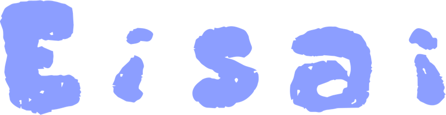
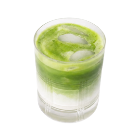
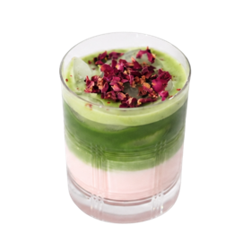
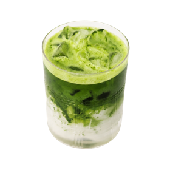

<p align="center">
  <a href="https://eisaistudio.com">
    
  </a>
</p>

<p align="center">
  <em>a little matcha pop-up at UCF, whisked with care</em> 🍵
</p>

<p align="center">
  <a href="https://eisaistudio.com"></a>
  
</p>

<p align="center">
  
  
  
  
  
  
</p>

---

## 🍵 About

This is the source code for **[eisaistudio.com](https://eisaistudio.com)**: the website, API and mobile app for **Eisai Studio**, a matcha pop-up at UCF.

It started as our **COP 4331C Large Project** (due **November 15, 2026**). Instead of building a pretend app for a pretend business, we decided to find a real client and build something they'd actually use. Eisai said yes, so everything here ships to real customers. 💜

## 🎋 The team


Built by **Team 11**, led by **Ruba Ismail**.

| Who                | GitHub                                                 |
| ------------------ | ------------------------------------------------------ |
| **Ruba Ismail** ⭐ | [@rubaismail](https://github.com/rubaismail)           |
| Brandon Dang       | [@brandenxo](https://github.com/brandenxo)             |
| Maryam Fathey      | [@rumitv](https://github.com/rumitv)                   |
| Zaim Merchant      | [@zaimm09](https://github.com/zaimm09)                 |
| Jesica Bermudes    | [@cheriu](https://github.com/cheriu)                   |
| Jeremy Triana      | [@Jeremytriana811](https://github.com/Jeremytriana811) |

<br clear="right">

## 🗺️ Where to find things

- **Tasks and dates:** [Team 11 Roadmap](https://github.com/users/rubaismail/projects/13/views/1?groupedBy%5BcolumnId%5D=425722583)
- **Where your code goes and how to open a PR:** [docs/team-guide.md](docs/team-guide.md)
- **API endpoints, authentication and examples:** [API reference](docs/api/README.md)
- **App development guides:** [Website](apps/web/README.md) · [Mobile](apps/mobile/mobileREADME.md)

| Part       | Tech                        | Folder                               |
| ---------- | --------------------------- | ------------------------------------ |
| Website    | React, TypeScript, Tailwind | [`apps/web`](apps/web)               |
| API        | Node, Express, Mongoose     | [`apps/api`](apps/api)               |
| Database   | MongoDB Atlas               | (cloud; connect via `apps/api/.env`) |
| Mobile app | Flutter                     | [`apps/mobile`](apps/mobile)         |

## 🌱 Setup (once per laptop)

You need **Node.js 24 LTS** ([download](https://nodejs.org); `node -v` should say v24) and **Git**.

```sh
git clone https://github.com/rubaismail/eisai-studio-matcha.git
cd eisai-studio-matcha
npm install
npm run setup
```

`npm run setup` creates `apps/api/.env`. Open it and paste the Atlas connection string after `MONGODB_URI=`. Get it from the Database person on the team chat, never from GitHub.

Then load sample drinks (once) and start everything:

```sh
npm run seed
npm run dev
```

Open **http://localhost:5173**. You should see the home page, and the Menu page should list two sample drinks. The API runs at http://localhost:4000/api.

Working on mobile? Follow [apps/mobile/mobileREADME.md](apps/mobile/mobileREADME.md) after the steps above.

## 🧋 Everyday commands (run from this folder)

| Command          | What it does                                                                 |
| ---------------- | ---------------------------------------------------------------------------- |
| `npm run dev`    | Starts the website and API together. Ctrl+C to stop.                         |
| `npm run seed`   | Adds the sample menu items if they're missing.                               |
| `npm test`       | Runs the web and API tests.                                                  |
| `npm run check`  | Lint + type check + tests + build. Run before every PR (GitHub runs it too). |
| `npm run format` | Auto-formats your code.                                                      |

## 🩹 Something not working?

- **"MONGODB_URI is empty"**: you skipped pasting the connection string into `apps/api/.env`.
- **Can't connect to MongoDB**: ask the Database person to add your IP in Atlas (Network Access), or check your Wi-Fi isn't blocking it.
- **Menu page says "Couldn't load the menu"**: the API isn't running or crashed. Look at the green `[api]` lines in your terminal.
- **Port already in use**: another `npm run dev` is still running in a different terminal. Stop it.

---

<p align="center">
  
  <br>
  <sub>made with matcha and love by Team 11 · <a href="https://eisaistudio.com">eisaistudio.com</a></sub>
</p>
